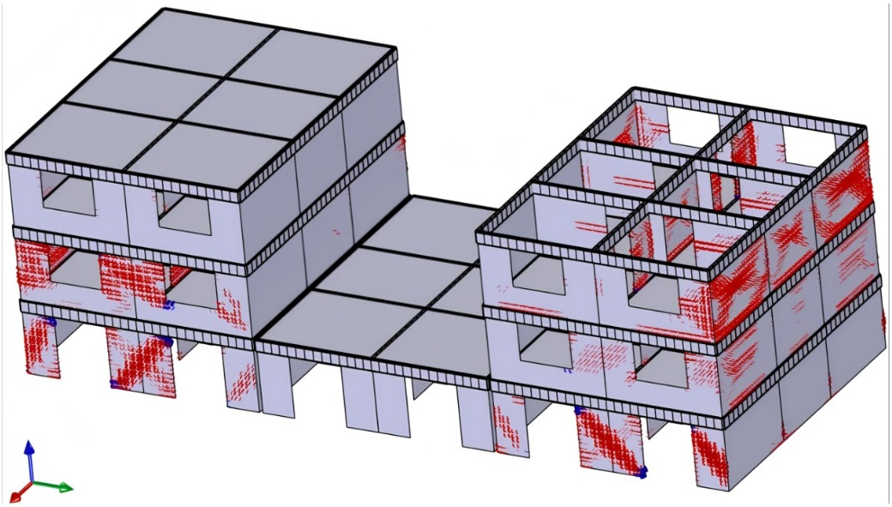
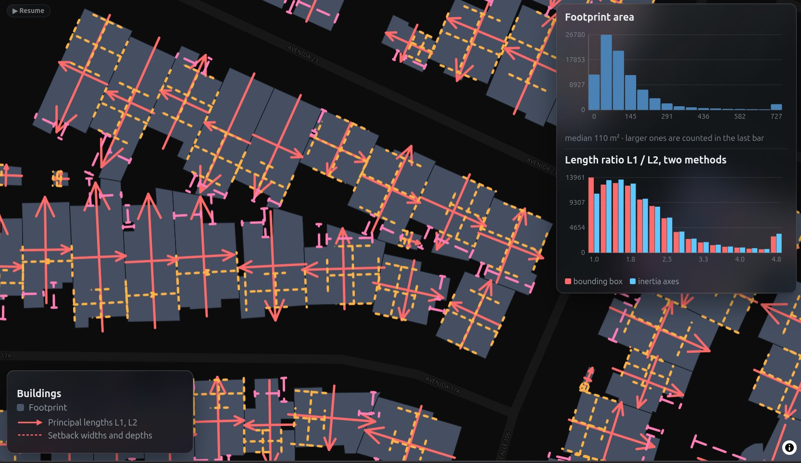
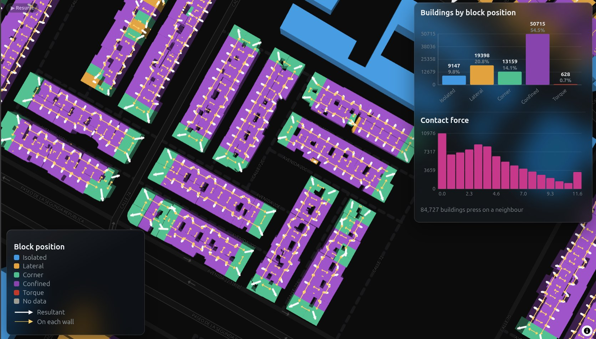

<!-- _class: titleslide -->
<!-- _paginate: false -->

# Buildingquake

## Earthquake risk per building anywhere in the world

Miguel Ureña Pliego

MIT Media Lab · Universidad Politécnica de Madrid

Project authors: Miguel Ureña Pliego, Javier Sempere Hernández, Advanced Geomatics (AGA) and City Science Groups

---

<!-- _class: risk -->

Risk

=

Exposure

×

Hazard

<svg viewBox="0 0 1080 360" xmlns="http://www.w3.org/2000/svg"><g transform="translate(0,34)"></g></svg>

---

<!-- _class: risk -->

Risk

=

Exposure

×

Hazard

<svg viewBox="0 0 1080 360" xmlns="http://www.w3.org/2000/svg"><g transform="translate(0,34)"><line x1="90" y1="10" x2="90" y2="52" stroke="#ffb000" stroke-width="5"/><polygon points="79,48 101,48 90,66" fill="#ffb000"/><text x="90" y="110" font-size="42" font-weight="700" text-anchor="middle" style="fill:#fff" >Damage</text><line x1="430" y1="10" x2="430" y2="52" stroke="#ffb000" stroke-width="5"/><polygon points="419,48 441,48 430,66" fill="#ffb000"/><text x="430" y="110" font-size="42" font-weight="700" text-anchor="middle" style="fill:#fff" >Buildings</text><line x1="880" y1="10" x2="880" y2="52" stroke="#ffb000" stroke-width="5"/><polygon points="869,48 891,48 880,66" fill="#ffb000"/><text x="880" y="110" font-size="42" font-weight="700" text-anchor="middle" style="fill:#fff" >Earthquake</text></g></svg>

---

<!-- _class: risk -->

Risk

=

Exposure

×

Earthquake

<svg viewBox="0 0 1080 360" xmlns="http://www.w3.org/2000/svg"><g transform="translate(0,34)"><line x1="90" y1="10" x2="90" y2="52" stroke="#ffb000" stroke-width="5"/><polygon points="79,48 101,48 90,66" fill="#ffb000"/><text x="90" y="110" font-size="42" font-weight="700" text-anchor="middle" style="fill:#fff" >Damage</text><line x1="430" y1="10" x2="430" y2="52" stroke="#ffb000" stroke-width="5"/><polygon points="419,48 441,48 430,66" fill="#ffb000"/><text x="430" y="110" font-size="42" font-weight="700" text-anchor="middle" style="fill:#fff" >Buildings</text><line x1="660" y1="255" x2="810" y2="255" stroke="#fff" stroke-width="4"/><line x1="664" y1="255" x2="654" y2="267" stroke="#fff" stroke-width="3"/><line x1="694" y1="255" x2="684" y2="267" stroke="#fff" stroke-width="3"/><line x1="724" y1="255" x2="714" y2="267" stroke="#fff" stroke-width="3"/><line x1="754" y1="255" x2="744" y2="267" stroke="#fff" stroke-width="3"/><line x1="784" y1="255" x2="774" y2="267" stroke="#fff" stroke-width="3"/><rect x="690" y="130" width="90" height="125" fill="none" stroke="#fff" stroke-width="4"/><line x1="690" y1="213.33333333333334" x2="780" y2="213.33333333333334" stroke="#fff" stroke-width="3"/><line x1="690" y1="171.66666666666669" x2="780" y2="171.66666666666669" stroke="#fff" stroke-width="3"/><rect x="704" y="145.0" width="22" height="22" fill="#fff" opacity=".55"/><rect x="748" y="145.0" width="22" height="22" fill="#fff" opacity=".55"/><rect x="704" y="186.7" width="22" height="22" fill="#fff" opacity=".55"/><rect x="748" y="186.7" width="22" height="22" fill="#fff" opacity=".55"/><rect x="704" y="228.4" width="22" height="22" fill="#fff" opacity=".55"/><rect x="748" y="228.4" width="22" height="22" fill="#fff" opacity=".55"/><line x1="684" y1="289" x2="786" y2="289" stroke="#ffb000" stroke-width="4"/><polygon points="676,289 692,280 692,298" fill="#ffb000"/><polygon points="794,289 778,280 778,298" fill="#ffb000"/><line x1="810" y1="160" x2="1078" y2="160" stroke="#8a8a8a" stroke-width="2"/><line x1="810" y1="65" x2="810" y2="255" stroke="#8a8a8a" stroke-width="2"/><polyline points="810.0,159.5 812.9,158.6 815.8,158.2 818.7,158.3 821.6,158.8 824.4,159.1 827.3,159.3 830.2,160.1 833.1,162.2 836.0,165.6 838.9,168.4 841.8,168.1 844.7,163.2 847.6,154.6 850.4,146.3 853.3,142.9 856.2,146.5 859.1,154.8 862.0,163.3 864.9,168.4 867.8,170.4 870.7,172.8 873.6,177.9 876.4,182.9 879.3,180.7 882.2,165.4 885.1,139.6 888.0,114.8 890.9,105.9 893.8,120.1 896.7,151.5 899.6,184.0 902.4,202.3 905.3,202.0 908.2,190.7 911.1,179.6 914.0,173.8 916.9,168.2 919.8,154.4 922.7,130.8 925.6,107.7 928.4,100.6 931.3,118.6 934.2,155.8 937.1,194.0 940.0,214.7 942.9,210.6 945.8,189.4 948.7,165.8 951.6,150.9 954.4,146.1 957.3,145.4 960.2,143.1 963.1,139.2 966.0,138.9 968.9,146.4 971.8,160.9 974.7,175.8 977.6,183.5 980.4,180.9 983.3,170.8 986.2,159.5 989.1,152.3 992.0,150.8 994.9,153.0 997.8,155.8 1000.7,157.5 1003.6,158.4 1006.4,159.4 1009.3,161.0 1012.2,162.7 1015.1,163.5 1018.0,163.0 1020.9,161.4 1023.8,159.7 1026.7,158.6 1029.6,158.5 1032.4,158.9 1035.3,159.6 1038.2,160.0 1041.1,160.2 1044.0,160.2 1046.9,160.2 1049.8,160.2 1052.7,160.2 1055.6,160.1 1058.4,160.1 1061.3,160.0 1064.2,159.9 1067.1,159.9 1070.0,159.9" fill="none" stroke="#fff" stroke-width="3" stroke-linejoin="round"/><line x1="810" y1="100.6" x2="1070" y2="100.6" stroke="#ffb000" stroke-width="2" stroke-dasharray="6 6"/><circle cx="928.4" cy="100.6" r="7" fill="#ffb000"/><text x="1070" y="285" font-size="22" font-weight="400" text-anchor="end" style="fill:#8a8a8a" >time</text><text x="818" y="56" font-size="22" font-weight="400" text-anchor="start" style="fill:#8a8a8a" >a(t)</text></g></svg>

---

<!-- _class: risk -->

Risk

=

Buildings

×

Earthquake

<svg viewBox="0 0 1080 360" xmlns="http://www.w3.org/2000/svg"><g transform="translate(0,34)"><line x1="90" y1="10" x2="90" y2="52" stroke="#ffb000" stroke-width="5"/><polygon points="79,48 101,48 90,66" fill="#ffb000"/><text x="90" y="110" font-size="42" font-weight="700" text-anchor="middle" style="fill:#fff" >Damage</text><line x1="300" y1="255" x2="630" y2="255" stroke="#fff" stroke-width="3"/><line x1="300" y1="255" x2="300" y2="61" stroke="#fff" stroke-width="3"/><polyline points="300,253.4 304,253.2 308,253.0 312,252.8 316,252.5 320,252.3 324,251.9 328,251.6 332,251.2 336,250.8 340,250.3 344,249.7 348,249.1 352,248.5 356,247.7 360,246.9 364,246.0 368,245.0 372,243.9 376,242.7 380,241.3 384,239.9 388,238.3 392,236.5 396,234.6 400,232.5 404,230.2 408,227.7 412,225.0 416,222.2 420,219.1 424,215.8 428,212.3 432,208.5 436,204.6 440,200.5 444,196.2 448,191.7 452,187.0 456,182.3 460,177.4 464,172.5 468,167.5 472,162.5 476,157.5 480,152.6 484,147.7 488,143.0 492,138.3 496,133.8 500,129.5 504,125.4 508,121.5 512,117.7 516,114.2 520,110.9 524,107.8 528,105.0 532,102.3 536,99.8 540,97.5 544,95.4 548,93.5 552,91.7 556,90.1 560,88.7 564,87.3 568,86.1 572,85.0 576,84.0 580,83.1 584,82.3 588,81.5 592,80.9 596,80.3 600,79.7 604,79.2 608,78.8 612,78.4 616,78.1 620,77.7" fill="none" stroke="#ffb000" stroke-width="6" stroke-linejoin="round"/><text x="460.0" y="295" font-size="24" font-weight="400" text-anchor="middle" style="fill:#8a8a8a" >acceleration</text><text x="284" y="165.0" font-size="24" font-weight="400" text-anchor="middle" style="fill:#8a8a8a" transform="rotate(-90 284 165.0)">P(damage)</text><text x="424" y="49" font-size="26" font-weight="700" text-anchor="end" style="fill:#fff" >Fragility curve</text><line x1="660" y1="255" x2="810" y2="255" stroke="#fff" stroke-width="4"/><line x1="664" y1="255" x2="654" y2="267" stroke="#fff" stroke-width="3"/><line x1="694" y1="255" x2="684" y2="267" stroke="#fff" stroke-width="3"/><line x1="724" y1="255" x2="714" y2="267" stroke="#fff" stroke-width="3"/><line x1="754" y1="255" x2="744" y2="267" stroke="#fff" stroke-width="3"/><line x1="784" y1="255" x2="774" y2="267" stroke="#fff" stroke-width="3"/><rect x="690" y="130" width="90" height="125" fill="none" stroke="#fff" stroke-width="4"/><line x1="690" y1="213.33333333333334" x2="780" y2="213.33333333333334" stroke="#fff" stroke-width="3"/><line x1="690" y1="171.66666666666669" x2="780" y2="171.66666666666669" stroke="#fff" stroke-width="3"/><rect x="704" y="145.0" width="22" height="22" fill="#fff" opacity=".55"/><rect x="748" y="145.0" width="22" height="22" fill="#fff" opacity=".55"/><rect x="704" y="186.7" width="22" height="22" fill="#fff" opacity=".55"/><rect x="748" y="186.7" width="22" height="22" fill="#fff" opacity=".55"/><rect x="704" y="228.4" width="22" height="22" fill="#fff" opacity=".55"/><rect x="748" y="228.4" width="22" height="22" fill="#fff" opacity=".55"/><line x1="684" y1="289" x2="786" y2="289" stroke="#ffb000" stroke-width="4"/><polygon points="676,289 692,280 692,298" fill="#ffb000"/><polygon points="794,289 778,280 778,298" fill="#ffb000"/><line x1="810" y1="160" x2="1078" y2="160" stroke="#8a8a8a" stroke-width="2"/><line x1="810" y1="65" x2="810" y2="255" stroke="#8a8a8a" stroke-width="2"/><polyline points="810.0,159.5 812.9,158.6 815.8,158.2 818.7,158.3 821.6,158.8 824.4,159.1 827.3,159.3 830.2,160.1 833.1,162.2 836.0,165.6 838.9,168.4 841.8,168.1 844.7,163.2 847.6,154.6 850.4,146.3 853.3,142.9 856.2,146.5 859.1,154.8 862.0,163.3 864.9,168.4 867.8,170.4 870.7,172.8 873.6,177.9 876.4,182.9 879.3,180.7 882.2,165.4 885.1,139.6 888.0,114.8 890.9,105.9 893.8,120.1 896.7,151.5 899.6,184.0 902.4,202.3 905.3,202.0 908.2,190.7 911.1,179.6 914.0,173.8 916.9,168.2 919.8,154.4 922.7,130.8 925.6,107.7 928.4,100.6 931.3,118.6 934.2,155.8 937.1,194.0 940.0,214.7 942.9,210.6 945.8,189.4 948.7,165.8 951.6,150.9 954.4,146.1 957.3,145.4 960.2,143.1 963.1,139.2 966.0,138.9 968.9,146.4 971.8,160.9 974.7,175.8 977.6,183.5 980.4,180.9 983.3,170.8 986.2,159.5 989.1,152.3 992.0,150.8 994.9,153.0 997.8,155.8 1000.7,157.5 1003.6,158.4 1006.4,159.4 1009.3,161.0 1012.2,162.7 1015.1,163.5 1018.0,163.0 1020.9,161.4 1023.8,159.7 1026.7,158.6 1029.6,158.5 1032.4,158.9 1035.3,159.6 1038.2,160.0 1041.1,160.2 1044.0,160.2 1046.9,160.2 1049.8,160.2 1052.7,160.2 1055.6,160.1 1058.4,160.1 1061.3,160.0 1064.2,159.9 1067.1,159.9 1070.0,159.9" fill="none" stroke="#fff" stroke-width="3" stroke-linejoin="round"/><line x1="810" y1="100.6" x2="1070" y2="100.6" stroke="#ffb000" stroke-width="2" stroke-dasharray="6 6"/><circle cx="928.4" cy="100.6" r="7" fill="#ffb000"/><text x="1070" y="285" font-size="22" font-weight="400" text-anchor="end" style="fill:#8a8a8a" >time</text><text x="818" y="56" font-size="22" font-weight="400" text-anchor="start" style="fill:#8a8a8a" >a(t)</text></g></svg>

---

<!-- _class: risk -->

Risk

=

Buildings

×

Earthquake

<svg viewBox="0 0 1080 360" xmlns="http://www.w3.org/2000/svg"><g transform="translate(0,34)"><line x1="90" y1="10" x2="90" y2="52" stroke="#ffb000" stroke-width="5"/><polygon points="79,48 101,48 90,66" fill="#ffb000"/><text x="96" y="100" font-size="28" font-weight="700" text-anchor="middle" style="fill:#ffb000" >29% damage</text><text x="96" y="134" font-size="28" font-weight="700" text-anchor="middle" style="fill:#ffb000" >probability</text><line x1="300" y1="255" x2="630" y2="255" stroke="#fff" stroke-width="3"/><line x1="300" y1="255" x2="300" y2="61" stroke="#fff" stroke-width="3"/><polyline points="300,253.4 304,253.2 308,253.0 312,252.8 316,252.5 320,252.3 324,251.9 328,251.6 332,251.2 336,250.8 340,250.3 344,249.7 348,249.1 352,248.5 356,247.7 360,246.9 364,246.0 368,245.0 372,243.9 376,242.7 380,241.3 384,239.9 388,238.3 392,236.5 396,234.6 400,232.5 404,230.2 408,227.7 412,225.0 416,222.2 420,219.1 424,215.8 428,212.3 432,208.5 436,204.6 440,200.5 444,196.2 448,191.7 452,187.0 456,182.3 460,177.4 464,172.5 468,167.5 472,162.5 476,157.5 480,152.6 484,147.7 488,143.0 492,138.3 496,133.8 500,129.5 504,125.4 508,121.5 512,117.7 516,114.2 520,110.9 524,107.8 528,105.0 532,102.3 536,99.8 540,97.5 544,95.4 548,93.5 552,91.7 556,90.1 560,88.7 564,87.3 568,86.1 572,85.0 576,84.0 580,83.1 584,82.3 588,81.5 592,80.9 596,80.3 600,79.7 604,79.2 608,78.8 612,78.4 616,78.1 620,77.7" fill="none" stroke="#ffb000" stroke-width="6" stroke-linejoin="round"/><text x="460.0" y="295" font-size="24" font-weight="400" text-anchor="middle" style="fill:#8a8a8a" >acceleration</text><text x="284" y="165.0" font-size="24" font-weight="400" text-anchor="middle" style="fill:#8a8a8a" transform="rotate(-90 284 165.0)">P(damage)</text><text x="424" y="49" font-size="26" font-weight="700" text-anchor="end" style="fill:#fff" >Fragility curve</text><line x1="660" y1="255" x2="810" y2="255" stroke="#fff" stroke-width="4"/><line x1="664" y1="255" x2="654" y2="267" stroke="#fff" stroke-width="3"/><line x1="694" y1="255" x2="684" y2="267" stroke="#fff" stroke-width="3"/><line x1="724" y1="255" x2="714" y2="267" stroke="#fff" stroke-width="3"/><line x1="754" y1="255" x2="744" y2="267" stroke="#fff" stroke-width="3"/><line x1="784" y1="255" x2="774" y2="267" stroke="#fff" stroke-width="3"/><rect x="690" y="130" width="90" height="125" fill="none" stroke="#fff" stroke-width="4"/><line x1="690" y1="213.33333333333334" x2="780" y2="213.33333333333334" stroke="#fff" stroke-width="3"/><line x1="690" y1="171.66666666666669" x2="780" y2="171.66666666666669" stroke="#fff" stroke-width="3"/><rect x="704" y="145.0" width="22" height="22" fill="#fff" opacity=".55"/><rect x="748" y="145.0" width="22" height="22" fill="#fff" opacity=".55"/><rect x="704" y="186.7" width="22" height="22" fill="#fff" opacity=".55"/><rect x="748" y="186.7" width="22" height="22" fill="#fff" opacity=".55"/><rect x="704" y="228.4" width="22" height="22" fill="#fff" opacity=".55"/><rect x="748" y="228.4" width="22" height="22" fill="#fff" opacity=".55"/><line x1="684" y1="289" x2="786" y2="289" stroke="#ffb000" stroke-width="4"/><polygon points="676,289 692,280 692,298" fill="#ffb000"/><polygon points="794,289 778,280 778,298" fill="#ffb000"/><line x1="810" y1="160" x2="1078" y2="160" stroke="#8a8a8a" stroke-width="2"/><line x1="810" y1="65" x2="810" y2="255" stroke="#8a8a8a" stroke-width="2"/><polyline points="810.0,159.5 812.9,158.6 815.8,158.2 818.7,158.3 821.6,158.8 824.4,159.1 827.3,159.3 830.2,160.1 833.1,162.2 836.0,165.6 838.9,168.4 841.8,168.1 844.7,163.2 847.6,154.6 850.4,146.3 853.3,142.9 856.2,146.5 859.1,154.8 862.0,163.3 864.9,168.4 867.8,170.4 870.7,172.8 873.6,177.9 876.4,182.9 879.3,180.7 882.2,165.4 885.1,139.6 888.0,114.8 890.9,105.9 893.8,120.1 896.7,151.5 899.6,184.0 902.4,202.3 905.3,202.0 908.2,190.7 911.1,179.6 914.0,173.8 916.9,168.2 919.8,154.4 922.7,130.8 925.6,107.7 928.4,100.6 931.3,118.6 934.2,155.8 937.1,194.0 940.0,214.7 942.9,210.6 945.8,189.4 948.7,165.8 951.6,150.9 954.4,146.1 957.3,145.4 960.2,143.1 963.1,139.2 966.0,138.9 968.9,146.4 971.8,160.9 974.7,175.8 977.6,183.5 980.4,180.9 983.3,170.8 986.2,159.5 989.1,152.3 992.0,150.8 994.9,153.0 997.8,155.8 1000.7,157.5 1003.6,158.4 1006.4,159.4 1009.3,161.0 1012.2,162.7 1015.1,163.5 1018.0,163.0 1020.9,161.4 1023.8,159.7 1026.7,158.6 1029.6,158.5 1032.4,158.9 1035.3,159.6 1038.2,160.0 1041.1,160.2 1044.0,160.2 1046.9,160.2 1049.8,160.2 1052.7,160.2 1055.6,160.1 1058.4,160.1 1061.3,160.0 1064.2,159.9 1067.1,159.9 1070.0,159.9" fill="none" stroke="#fff" stroke-width="3" stroke-linejoin="round"/><line x1="810" y1="100.6" x2="1070" y2="100.6" stroke="#ffb000" stroke-width="2" stroke-dasharray="6 6"/><circle cx="928.4" cy="100.6" r="7" fill="#ffb000"/><text x="1070" y="285" font-size="22" font-weight="400" text-anchor="end" style="fill:#8a8a8a" >time</text><text x="818" y="56" font-size="22" font-weight="400" text-anchor="start" style="fill:#8a8a8a" >a(t)</text><polyline points="928.4,100.6 928.4,12 438,12 438,190.6" fill="none" stroke="#ffb000" stroke-width="4" stroke-dasharray="9 7"/><polygon points="429,188.6 447,188.6 438,202.6" fill="#ffb000"/><circle cx="438" cy="202.6" r="8" fill="#fff"/><line x1="428" y1="202.6" x2="314" y2="202.6" stroke="#fff" stroke-width="4" stroke-dasharray="9 7"/><polygon points="316,193.6 316,211.6 302,202.6" fill="#fff"/><text x="322" y="188.5589485052984" font-size="30" font-weight="700" text-anchor="start" style="fill:#fff" >29 %</text><line x1="438" y1="255" x2="438" y2="247" stroke="#ffb000" stroke-width="4"/></g></svg>

---

<!-- _class: fig2 -->

# Fragility curves

<svg viewBox="0 0 560 420" xmlns="http://www.w3.org/2000/svg"><g transform="translate(34,0)"><line x1="70" y1="195.0" x2="500" y2="195.0" stroke="#333" stroke-width="2" stroke-dasharray="6 6"/><line x1="70" y1="40.0" x2="500" y2="40.0" stroke="#333" stroke-width="2" stroke-dasharray="6 6"/><line x1="70" y1="350" x2="510" y2="350" stroke="#fff" stroke-width="3"/><line x1="70" y1="350" x2="70" y2="26" stroke="#fff" stroke-width="3"/><text x="60" y="357" font-size="20" font-weight="400" text-anchor="end" style="fill:#8a8a8a" >0</text><text x="60" y="202.0" font-size="20" font-weight="400" text-anchor="end" style="fill:#8a8a8a" >50 %</text><text x="60" y="47.0" font-size="20" font-weight="400" text-anchor="end" style="fill:#8a8a8a" >100 %</text><polyline points="70.0,350 73.6,350.0 77.2,349.9 80.8,349.2 84.3,346.5 87.9,340.5 91.5,330.9 95.1,317.8 98.7,302.1 102.2,284.6 105.8,266.2 109.4,247.5 113.0,229.2 116.6,211.6 120.2,195.0 123.8,179.5 127.3,165.3 130.9,152.2 134.5,140.4 138.1,129.7 141.7,120.1 145.2,111.5 148.8,103.7 152.4,96.8 156.0,90.7 159.6,85.2 163.2,80.4 166.8,76.0 170.3,72.2 173.9,68.7 177.5,65.7 181.1,63.0 184.7,60.6 188.2,58.4 191.8,56.5 195.4,54.8 199.0,53.3 202.6,52.0 206.2,50.8 209.7,49.7 213.3,48.7 216.9,47.9 220.5,47.1 224.1,46.4 227.7,45.8 231.2,45.2 234.8,44.7 238.4,44.3 242.0,43.9 245.6,43.5 249.2,43.2 252.8,42.9 256.3,42.6 259.9,42.4 263.5,42.2 267.1,42.0 270.7,41.8 274.2,41.7 277.8,41.5 281.4,41.4 285.0,41.3 288.6,41.2 292.2,41.1 295.8,41.0 299.3,40.9 302.9,40.8 306.5,40.7 310.1,40.7 313.7,40.6 317.2,40.6 320.8,40.5 324.4,40.5 328.0,40.5 331.6,40.4 335.2,40.4 338.8,40.4 342.3,40.3 345.9,40.3 349.5,40.3 353.1,40.3 356.7,40.2 360.2,40.2 363.8,40.2 367.4,40.2 371.0,40.2 374.6,40.2 378.2,40.1 381.8,40.1 385.3,40.1 388.9,40.1 392.5,40.1 396.1,40.1 399.7,40.1 403.2,40.1 406.8,40.1 410.4,40.1 414.0,40.1 417.6,40.1 421.2,40.1 424.8,40.1 428.3,40.1 431.9,40.1 435.5,40.0 439.1,40.0 442.7,40.0 446.3,40.0 449.8,40.0 453.4,40.0 457.0,40.0 460.6,40.0 464.2,40.0 467.7,40.0 471.3,40.0 474.9,40.0 478.5,40.0 482.1,40.0 485.7,40.0 489.3,40.0 492.8,40.0 496.4,40.0 500.0,40.0" fill="none" stroke="#ffe27a" stroke-width="6" stroke-linejoin="round"/><polyline points="70.0,350 73.6,350.0 77.2,350.0 80.8,350.0 84.3,349.9 87.9,349.7 91.5,349.2 95.1,348.2 98.7,346.5 102.2,343.9 105.8,340.5 109.4,336.1 113.0,330.9 116.6,324.7 120.2,317.8 123.8,310.3 127.3,302.1 130.9,293.5 134.5,284.6 138.1,275.5 141.7,266.2 145.2,256.9 148.8,247.5 152.4,238.3 156.0,229.2 159.6,220.3 163.2,211.6 166.8,203.2 170.3,195.0 173.9,187.1 177.5,179.5 181.1,172.2 184.7,165.3 188.2,158.6 191.8,152.2 195.4,146.2 199.0,140.4 202.6,134.9 206.2,129.7 209.7,124.8 213.3,120.1 216.9,115.6 220.5,111.5 224.1,107.5 227.7,103.7 231.2,100.2 234.8,96.8 238.4,93.7 242.0,90.7 245.6,87.9 249.2,85.2 252.8,82.7 256.3,80.4 259.9,78.1 263.5,76.0 267.1,74.0 270.7,72.2 274.2,70.4 277.8,68.7 281.4,67.2 285.0,65.7 288.6,64.3 292.2,63.0 295.8,61.8 299.3,60.6 302.9,59.5 306.5,58.4 310.1,57.5 313.7,56.5 317.2,55.7 320.8,54.8 324.4,54.1 328.0,53.3 331.6,52.6 335.2,52.0 338.8,51.3 342.3,50.8 345.9,50.2 349.5,49.7 353.1,49.2 356.7,48.7 360.2,48.3 363.8,47.9 367.4,47.5 371.0,47.1 374.6,46.7 378.2,46.4 381.8,46.1 385.3,45.8 388.9,45.5 392.5,45.2 396.1,45.0 399.7,44.7 403.2,44.5 406.8,44.3 410.4,44.1 414.0,43.9 417.6,43.7 421.2,43.5 424.8,43.4 428.3,43.2 431.9,43.0 435.5,42.9 439.1,42.8 442.7,42.6 446.3,42.5 449.8,42.4 453.4,42.3 457.0,42.2 460.6,42.1 464.2,42.0 467.7,41.9 471.3,41.8 474.9,41.7 478.5,41.7 482.1,41.6 485.7,41.5 489.3,41.4 492.8,41.4 496.4,41.3 500.0,41.3" fill="none" stroke="#ffb000" stroke-width="6" stroke-linejoin="round"/><polyline points="70.0,350 73.6,350.0 77.2,350.0 80.8,350.0 84.3,350.0 87.9,350.0 91.5,350.0 95.1,349.9 98.7,349.9 102.2,349.7 105.8,349.5 109.4,349.1 113.0,348.5 116.6,347.8 120.2,346.8 123.8,345.6 127.3,344.1 130.9,342.3 134.5,340.2 138.1,337.8 141.7,335.2 145.2,332.2 148.8,329.0 152.4,325.5 156.0,321.8 159.6,317.8 163.2,313.7 166.8,309.3 170.3,304.8 173.9,300.1 177.5,295.3 181.1,290.4 184.7,285.3 188.2,280.3 191.8,275.1 195.4,269.9 199.0,264.7 202.6,259.5 206.2,254.2 209.7,249.0 213.3,243.8 216.9,238.7 220.5,233.6 224.1,228.5 227.7,223.5 231.2,218.5 234.8,213.7 238.4,208.9 242.0,204.2 245.6,199.5 249.2,195.0 252.8,190.5 256.3,186.2 259.9,181.9 263.5,177.8 267.1,173.7 270.7,169.7 274.2,165.8 277.8,162.0 281.4,158.3 285.0,154.7 288.6,151.2 292.2,147.8 295.8,144.5 299.3,141.3 302.9,138.2 306.5,135.1 310.1,132.2 313.7,129.3 317.2,126.5 320.8,123.8 324.4,121.2 328.0,118.6 331.6,116.2 335.2,113.8 338.8,111.5 342.3,109.2 345.9,107.0 349.5,104.9 353.1,102.9 356.7,100.9 360.2,99.0 363.8,97.1 367.4,95.3 371.0,93.6 374.6,91.9 378.2,90.2 381.8,88.7 385.3,87.1 388.9,85.6 392.5,84.2 396.1,82.8 399.7,81.5 403.2,80.2 406.8,78.9 410.4,77.7 414.0,76.5 417.6,75.4 421.2,74.3 424.8,73.2 428.3,72.2 431.9,71.2 435.5,70.2 439.1,69.3 442.7,68.4 446.3,67.5 449.8,66.6 453.4,65.8 457.0,65.0 460.6,64.3 464.2,63.5 467.7,62.8 471.3,62.1 474.9,61.4 478.5,60.8 482.1,60.1 485.7,59.5 489.3,58.9 492.8,58.4 496.4,57.8 500.0,57.3" fill="none" stroke="#ff6a1f" stroke-width="6" stroke-linejoin="round"/><polyline points="70.0,350 73.6,350.0 77.2,350.0 80.8,350.0 84.3,350.0 87.9,350.0 91.5,350.0 95.1,350.0 98.7,350.0 102.2,350.0 105.8,350.0 109.4,350.0 113.0,349.9 116.6,349.9 120.2,349.8 123.8,349.8 127.3,349.6 130.9,349.5 134.5,349.3 138.1,349.0 141.7,348.7 145.2,348.3 148.8,347.8 152.4,347.3 156.0,346.7 159.6,346.0 163.2,345.2 166.8,344.3 170.3,343.3 173.9,342.2 177.5,341.0 181.1,339.7 184.7,338.3 188.2,336.8 191.8,335.2 195.4,333.5 199.0,331.7 202.6,329.8 206.2,327.8 209.7,325.7 213.3,323.6 216.9,321.3 220.5,319.0 224.1,316.6 227.7,314.2 231.2,311.6 234.8,309.0 238.4,306.4 242.0,303.7 245.6,300.9 249.2,298.1 252.8,295.3 256.3,292.4 259.9,289.5 263.5,286.5 267.1,283.6 270.7,280.6 274.2,277.5 277.8,274.5 281.4,271.4 285.0,268.4 288.6,265.3 292.2,262.2 295.8,259.2 299.3,256.1 302.9,253.0 306.5,249.9 310.1,246.9 313.7,243.8 317.2,240.8 320.8,237.8 324.4,234.8 328.0,231.8 331.6,228.8 335.2,225.8 338.8,222.9 342.3,220.0 345.9,217.1 349.5,214.2 353.1,211.4 356.7,208.6 360.2,205.8 363.8,203.1 367.4,200.4 371.0,197.7 374.6,195.0 378.2,192.4 381.8,189.8 385.3,187.2 388.9,184.7 392.5,182.2 396.1,179.7 399.7,177.3 403.2,174.9 406.8,172.5 410.4,170.2 414.0,167.9 417.6,165.6 421.2,163.4 424.8,161.2 428.3,159.0 431.9,156.8 435.5,154.7 439.1,152.7 442.7,150.6 446.3,148.6 449.8,146.7 453.4,144.7 457.0,142.8 460.6,140.9 464.2,139.1 467.7,137.3 471.3,135.5 474.9,133.7 478.5,132.0 482.1,130.3 485.7,128.6 489.3,127.0 492.8,125.4 496.4,123.8 500.0,122.3" fill="none" stroke="#e5322b" stroke-width="6" stroke-linejoin="round"/><text x="285.0" y="394" font-size="24" font-weight="400" text-anchor="middle" style="fill:#8a8a8a" >ground acceleration</text><line x1="350" y1="218" x2="382" y2="218" stroke="#ffe27a" stroke-width="6"/><text x="392" y="225" font-size="22" font-weight="700" text-anchor="start" style="fill:#fff" >Slight</text><line x1="350" y1="248" x2="382" y2="248" stroke="#ffb000" stroke-width="6"/><text x="392" y="255" font-size="22" font-weight="700" text-anchor="start" style="fill:#fff" >Moderate</text><line x1="350" y1="278" x2="382" y2="278" stroke="#ff6a1f" stroke-width="6"/><text x="392" y="285" font-size="22" font-weight="700" text-anchor="start" style="fill:#fff" >Extensive</text><line x1="350" y1="308" x2="382" y2="308" stroke="#e5322b" stroke-width="6"/><text x="392" y="315" font-size="22" font-weight="700" text-anchor="start" style="fill:#fff" >Complete</text></g><text x="20" y="195.0" font-size="24" font-weight="400" text-anchor="middle" style="fill:#8a8a8a" transform="rotate(-90 20 195.0)">P(damage ≥ state)</text></svg>

---

<!-- _class: media -->

# Fragility curves

<video style="object-view-box:inset(0 0 0 9px)" src="./videos/capacity.mp4" autoplay loop muted playsinline></video>

---

# Exposure Building Database

<svg viewBox="0 0 1120 440" xmlns="http://www.w3.org/2000/svg"><g transform="translate(10,10)"><polygon points="30,40 120,30 130,100 40,110" fill="none" stroke="#fff" stroke-width="2.5" stroke-linejoin="round" opacity=".75"/><polygon points="140,30 230,25 235,95 145,100" fill="none" stroke="#fff" stroke-width="2.5" stroke-linejoin="round" opacity=".75"/><polygon points="245,25 330,30 325,100 240,95" fill="none" stroke="#fff" stroke-width="2.5" stroke-linejoin="round" opacity=".75"/><polygon points="345,35 430,45 420,110 335,100" fill="none" stroke="#fff" stroke-width="2.5" stroke-linejoin="round" opacity=".75"/><polygon points="35,125 110,120 115,200 40,205" fill="none" stroke="#fff" stroke-width="2.5" stroke-linejoin="round" opacity=".75"/><polygon points="125,118 200,115 205,160 130,165" fill="none" stroke="#fff" stroke-width="2.5" stroke-linejoin="round" opacity=".75"/><polygon points="125,170 205,168 208,205 128,207" fill="none" stroke="#fff" stroke-width="2.5" stroke-linejoin="round" opacity=".75"/><polygon points="225,115 300,112 302,205 228,208" fill="none" stroke="#fff" stroke-width="2.5" stroke-linejoin="round" opacity=".75"/><polygon points="315,118 420,125 415,200 318,205" fill="none" stroke="#fff" stroke-width="2.5" stroke-linejoin="round" opacity=".75"/><polygon points="40,225 130,222 133,300 45,305" fill="none" stroke="#fff" stroke-width="2.5" stroke-linejoin="round" opacity=".75"/><polygon points="235,222 330,218 335,300 238,303" fill="none" stroke="#fff" stroke-width="2.5" stroke-linejoin="round" opacity=".75"/><polygon points="345,225 425,228 420,305 340,300" fill="none" stroke="#fff" stroke-width="2.5" stroke-linejoin="round" opacity=".75"/><polygon points="30,325 150,322 152,395 35,398" fill="none" stroke="#fff" stroke-width="2.5" stroke-linejoin="round" opacity=".75"/><polygon points="165,325 260,322 262,395 168,398" fill="none" stroke="#fff" stroke-width="2.5" stroke-linejoin="round" opacity=".75"/><polygon points="275,322 425,325 420,395 278,398" fill="none" stroke="#fff" stroke-width="2.5" stroke-linejoin="round" opacity=".75"/><polygon points="145,222 220,220 222,260 190,262 188,300 148,302" fill="#fff" stroke="#fff" stroke-width="3" stroke-linejoin="round"/></g><path d="M 200 262 L 560 262" fill="none" stroke="#ffb000" stroke-width="3" stroke-dasharray="8 6"/><circle cx="200" cy="262" r="6" fill="#ffb000"/><rect x="560" y="10" width="550" height="420" rx="16" fill="#0d0d0d" stroke="#fff" stroke-width="3"/><text x="590" y="52" font-size="26" font-weight="700" style="fill:#ffb000">Record per footprint</text><line x1="590" y1="66" x2="1080" y2="66" stroke="#444" stroke-width="2"/><text x="590" y="100" font-size="22" style="fill:#8a8a8a">geometry</text><text x="810" y="100" font-size="22" font-weight="700" style="fill:#fff">polygon + area</text><text x="590" y="137" font-size="22" style="fill:#8a8a8a">height</text><text x="810" y="137" font-size="22" font-weight="700" style="fill:#fff">14 m · 4 floors</text><text x="590" y="174" font-size="22" style="fill:#8a8a8a">roof material</text><text x="810" y="174" font-size="22" font-weight="700" style="fill:#fff">concrete slab</text><text x="590" y="211" font-size="22" style="fill:#8a8a8a">year built</text><text x="810" y="211" font-size="22" font-weight="700" style="fill:#fff">1985</text><text x="590" y="248" font-size="22" style="fill:#8a8a8a">shape</text><text x="810" y="248" font-size="22" font-weight="700" style="fill:#fff">L-shaped · L1/L2 = 2.0</text><text x="590" y="285" font-size="22" style="fill:#8a8a8a">block position</text><text x="810" y="285" font-size="22" font-weight="700" style="fill:#fff">corner</text><text x="590" y="322" font-size="22" style="fill:#8a8a8a">ground motion</text><text x="810" y="322" font-size="22" font-weight="700" style="fill:#fff">−1.2 mm/yr</text><text x="590" y="359" font-size="22" style="fill:#8a8a8a">structural system</text><text x="810" y="359" font-size="22" font-weight="700" style="fill:#fff">RC frame + infill</text><text x="590" y="396" font-size="22" style="fill:#8a8a8a">fragility class</text><text x="810" y="396" font-size="22" font-weight="700" style="fill:#fff">MCF-L-4</text></svg>

---

<!-- _class: media -->

# Remote Sensing: Height

<video style="object-view-box:inset(0 0 0 6px)" src="./videos/height.mp4" autoplay loop muted playsinline></video>

---

<!-- _class: media -->

# Remote Sensing: Roof

<video style="object-view-box:inset(0 0 0 6px)" src="./videos/roof.mp4" autoplay loop muted playsinline></video>

---

<!-- _class: media -->

# Remote Sensing: Year

<video style="object-view-box:inset(0 0 0 6px)" src="./videos/year.mp4" autoplay loop muted playsinline></video>

---

<!-- _class: media figure -->

# Building regularity

---

<!-- _class: media -->

# Building regularity

<video style="object-view-box:inset(0 0 0 9px)" src="./videos/shape.mp4" autoplay loop muted playsinline></video>

---

<!-- _class: media figure -->

# Block position

---

<!-- _class: media scrim -->

# INSAR: Movements

<video src="./videos/citymotion.mp4" autoplay loop muted playsinline></video>

---

<!-- _class: media -->

# "Field" surveys

<video src="./videos/surveyor.mp4" autoplay loop muted playsinline></video>

---

<!-- _class: media -->

# Structural system

<video style="object-view-box:inset(0 0 0 9px)" src="./videos/structural_system.mp4" autoplay loop muted playsinline></video>

---

<!-- _class: media -->

# Hazard

<video src="./videos/hazard.mp4" autoplay loop muted playsinline></video>

---

<!-- _class: media -->

# Risk

<video style="object-view-box:inset(0 0 0 6px)" src="./videos/risk.mp4" autoplay loop muted playsinline></video>

---

<!-- _class: closing -->
<!-- _paginate: false -->

# Thank you!

<a class="n" href="https://miguelurenapliego.github.io/BuildingquakePresentation/">Presentation</a>

<a class="n" href="https://miguelurenapliego.github.io/BuildingquakePresentation/buildingquake-tool/">Tool</a>

<a class="n" href="https://miguelurenapliego.github.io/BuildingquakePresentation/surveyor-agent/">Surveyor agent</a>

<a class="n" href="https://link.springer.com/content/pdf/10.1186/s40323-026-00323-y.pdf">Paper</a>

<a class="n" href="https://www.linkedin.com/in/miguel-urena-pliego/">Miguel Ureña</a>

<a class="n" href="https://www.linkedin.com/in/javier-sempere/">Javier Sempere</a>

